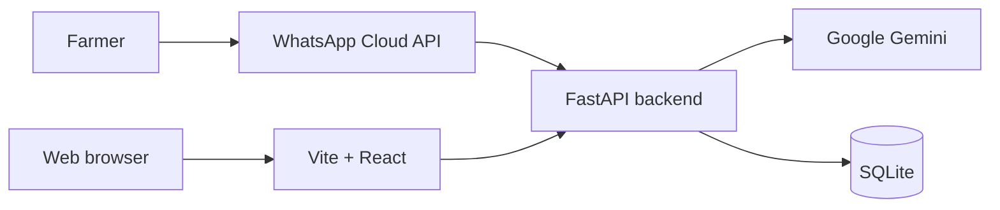

# MACHINATI — WhatsApp-First Agricultural Equipment Platform

A development MVP for collecting agricultural equipment requests through WhatsApp and reviewing them in a cooperative dashboard. It is not a production booking platform.

| **Languages** | Python 3.10+ · TypeScript |

---

## 1. Context and Goals

Farmers send text or voice requests through WhatsApp. The backend can transcribe voice messages, extract request details with Gemini, and save confirmed requests for human review. The frontend provides a machinery catalogue, cooperative views, and an API-backed requests dashboard.

## 2. Architecture



## 3. Functional Modules

### 3.1 WhatsApp Requests

- Receive text and voice messages through the WhatsApp webhook.
- Transcribe voice messages and extract request details when Gemini is configured.
- Ask follow-up questions and require explicit farmer confirmation before saving a request.

### 3.2 Cooperative Dashboard

- Review requests and their statuses.
- Approve or reject requests through the backend API.
- View the machine inventory returned by the API.

### 3.3 MACHINATI Website

- Browse the demonstration machinery catalogue.
- Open cooperative and operations demonstration pages.
- Read privacy, terms, and data-deletion information.

## 4. Technology Stack

| Component | Technology | Purpose |
|---|---|---|
| Backend API | Python, FastAPI | Webhook and dashboard endpoints |
| Database | SQLite | Requests, messages, and conversation state |
| AI | Google Gemini | Voice transcription and request extraction |
| Frontend | React, TypeScript, Vite | Catalogue and dashboard interfaces |
| Messaging | WhatsApp Cloud API | Farmer text and voice messages |

## 5. Project Structure

```text
.
├── backend/
│   ├── app/
│   │   ├── routes/       # Request and machine API routes
│   │   ├── ai.py         # Gemini extraction and transcription
│   │   ├── config.py     # Environment-based configuration
│   │   ├── db.py         # SQLite schema and connections
│   │   ├── main.py       # FastAPI app and WhatsApp webhook
│   │   ├── service.py    # Conversation and request workflow
│   │   └── whatsapp.py   # WhatsApp API integration
│   ├── tests/
│   └── requirements.txt
├── docs/                 # Setup, deployment, integration, and roadmap guides
├── frontend/
│   ├── public/
│   └── src/
├── .gitignore
├── README.md
└── run.sh                # Optional macOS/Linux launcher
```

## 6. Setup and Launch

### Requirements

- Python 3.10 or newer
- Node.js 20 or newer, including npm

### Create the Python environment

Run the commands for your platform from the repository root.

**Windows PowerShell**

```powershell
py -3 -m venv .venv
.venv\Scripts\Activate.ps1
```

**macOS / Linux**

```bash
python3 -m venv .venv
source .venv/bin/activate
```

Install backend and frontend dependencies:

```bash
python -m pip install -r backend/requirements.txt
npm ci --prefix frontend
```

Open two terminals in the repository root. Activate `.venv` in the backend terminal.

**Backend**

```bash
cd backend
python -m uvicorn app.main:app --reload
```

**Frontend**

```bash
npm --prefix frontend run dev
```

Open http://localhost:5173. The API documentation is available at http://localhost:8000/docs. On macOS/Linux, `./run.sh` can start both services together.

## 7. Configuration

Copy `backend/.env.example` to `backend/.env` and add the credentials needed for WhatsApp and Gemini.

Windows PowerShell:

```powershell
Copy-Item backend/.env.example backend/.env
```

macOS / Linux:

```bash
cp backend/.env.example backend/.env
```

Never commit `.env` or expose the unauthenticated API publicly. The current backend does not yet authenticate cooperative users.

## 8. Tests

With `.venv` active:

```bash
cd backend
python -m unittest discover -s tests -v
```

## 9. Current Limitations

- The backend API is unauthenticated and is not safe to expose publicly.
- Requests can be reviewed, but a confirmed booking, scheduling, and availability checks are not implemented.
- Catalogue and operations pages still contain demonstration data.
- WhatsApp and Gemini features require valid credentials in `backend/.env`.

## 10. Guides

- [Deployment and privacy pages](docs/deployment.md)
- [Gemini configuration](docs/gemini.md)
- [Frontend/backend integration](docs/frontend-backend-integration.md)
- [Product roadmap (French)](docs/roadmap-fr.md)
